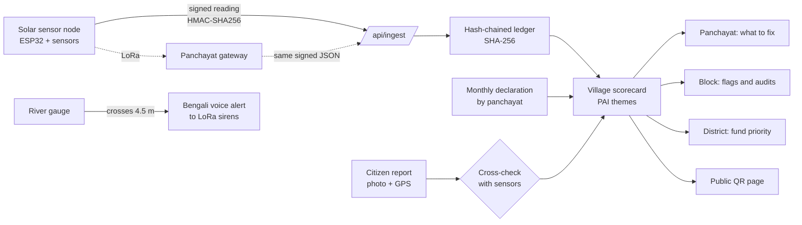

# GramSatya (গ্রামসত্য): a village whose data cannot be faked

Prototype for the **BharatSeva state hackathon**. GramSatya checks what a Gram Panchayat *declares* against what low-cost solar sensors *measure*. It turns the readings into a live, tamper-proof village scorecard that panchayats, block and district officers, and villagers can all see.

The problem statement is in [`docs/PROBLEM_STATEMENT.md`](docs/PROBLEM_STATEMENT.md).

> All villages, sensors and figures in the app are simulated demo data.

## What it does

| Feature | Where | What to show judges |
|---|---|---|
| **Declared vs measured scorecard** | Scorecard | Radhaganj declares 100% on everything, but the sensors show about 50%. The village is flagged and its data trust drops. |
| **Monthly declaration** | Scorecard, "Submit this month's declaration" | Enter honest figures and the red flag clears instantly. |
| **Tamper-proof ledger** | Ledger | Click "Simulate tampering": the chain breaks, the seal turns to "Data tampered", and trust drops everywhere. Then click "Restore". |
| **Signed device data** | Devices | "Start virtual device" acts as a repaired handpump: signed readings flow in and the sensor turns into "ESP32 signed". "Send a forged reading" gets rejected. |
| **Offline flood alerts** | Alerts | "Simulate storm surge": within about 20 seconds the river gauge crosses 4.5 m and sends a Bengali flood alert to the sirens by itself. One siren does not reply. |
| **Citizen reports checked by sensors** | Villager, then Report a problem | A report about a streetlight is confirmed by the streetlight sensor straight away. |
| **Ponds and check dams audit** | Ponds | MGNREGA and Amrit Sarovar ponds: 12-month water history and cost per month that each one actually held water. |
| **Fund priority** | District officer, then Funds | Budget split by verified need. Part of a village's share is held back while its data trust is low. |
| **Public QR page** | Scorecard, then QR code | A Bengali-first page villagers open from a QR code on the panchayat office wall. |
| **What to fix first** | Scorecard | Action plan in English and Bengali, with a Listen button. Uses built-in rules; can switch to Ollama, Gemini or any OpenAI-compatible API. |
| **Works offline** | Everywhere | Installable PWA. Reports are saved on the phone, and map tiles are cached. |

## Run it

```bash
npm install
npm run dev          # http://localhost:3000
```

Production build: `npm run build && npm start`.

### Try the hardware path without hardware

```bash
node scripts/device-sim.mjs --url http://localhost:3000 --sensor radhaganj-handpump-1
node scripts/device-sim.mjs --bad-signature        # shows a rejected reading
```

### Real ESP32

Open `firmware/esp32_node/esp32_node.ino` in Arduino IDE (board "ESP32 Dev Module"). Set Wi-Fi, `SERVER_URL`, `DEVICE_SECRET` and `SENSOR_ID` (sensor IDs are listed on the Devices page), then upload. The firmware supports a JSN-SR04T for tank or bin level, a YF-S201 for handpump flow, and an LDR or ACS712 for streetlights. Readings are signed with HMAC-SHA256.

Parts for one node cost roughly ₹2,000–3,000: ESP32, one or two sensors, an SX1278 LoRa module, a 6 V solar panel with TP4056 and an 18650 cell, and an IP65 box. These are approximate prices; check before buying.

## Settings (all optional)

Copy `.env.example` to `.env.local`.

| Variable | Use |
|---|---|
| `DEVICE_SECRET` | Shared secret for device signatures. Default `gramsatya-demo-secret`. |
| `AI_PROVIDER` | `ollama`, `gemini` or `openai`. Leave empty to use the built-in rules. |
| `OLLAMA_URL`, `OLLAMA_MODEL` | Local Ollama (default `http://localhost:11434`, `llama3.2`). Only works when the app runs on the same machine, not on Vercel. |
| `GEMINI_API_KEY`, `GEMINI_MODEL` | Google Gemini. |
| `OPENAI_API_KEY`, `OPENAI_MODEL`, `OPENAI_BASE_URL` | Any OpenAI-compatible API: OpenAI, Groq, OpenRouter or LM Studio. |

## How it works



- **Stack:** Next.js 16 (App Router), React 19, Tailwind CSS 4, Leaflet with OpenStreetMap, self-hosted Hind Siliguri and Tiro Bangla fonts.
- **Simulation:** `lib/sim.ts` makes deterministic sensor readings, faults and 30-day history, so the demo behaves the same every time.
- **Score:** water 30%, streetlights 20%, sanitation 20%, water assets 15% and responsiveness 15%, mapped to Panchayat Advancement Index themes. A village is flagged when it declares more than 15 points above what is measured.
- **Ledger:** `lib/ledger.ts` uses pure-JS SHA-256, so it also works offline and over plain http.
- **Storage:** the prototype keeps app state in the browser and device readings in server memory. A pilot would use a database such as Postgres.

## Project layout

```
app/                 pages (scorecard, villages, ponds, alerts, reports, ledger, funds, devices, public page /v/[id])
app/api/ingest       device readings (signed)
app/api/device-test  virtual device for demos
app/api/insights     AI or rule-based action plan
components/          app shell, seal, scorecard, sensor register, map
lib/                 data, simulation, ledger, insights, AI providers
firmware/            ESP32 sensor node
scripts/             device simulator
docs/                problem statement
```

## Team

Srinjoyee Dey
